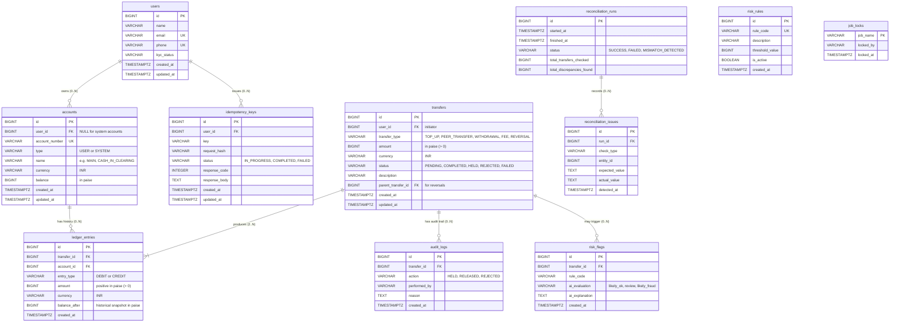

# Milestone 1: Database Schema & Double-Entry Ledger Design

## 1. Requirements Noun Analysis

To design a robust relational schema, we extract every noun from the business requirements and evaluate whether it justifies a dedicated table.

| Noun | Table Created? | Rationale |
| :--- | :--- | :--- |
| **User** | **Yes (`users`)** | Core identity entity storing personal data (name, email, phone) and KYC status. |
| **Wallet / Account** | **Yes (`accounts`)** | Financial container holding balances. Unifies user wallets and system clearing accounts under one domain model. |
| **Transfer** | **Yes (`transfers`)** | Represents the business event (intent, type, amount, status, timestamps, idempotency association). |
| **Ledger Entry** | **Yes (`ledger_entries`)** | Immutable double-entry records. Every transfer generates $\ge 2$ entries (Debits and Credits) that sum to zero. |
| **Idempotency Key** | **Yes (`idempotency_keys`)** | Ensures safe retries by associating a client-provided key and request hash with cached HTTP responses. |
| **Audit Log** | **Yes (`audit_logs`)** | Tracks administrative state transitions (e.g., fraud hold/release) with actor and timestamp. |
| **Risk Rule** | **Yes (`risk_rules`)** | Configurable fraud detection thresholds stored in the database rather than hardcoded in application logic. |
| **Risk Flag** | **Yes (`risk_flags`)** | Flags raised against suspicious transfers along with AI-generated risk evaluations. |
| **Reconciliation Run** | **Yes (`reconciliation_runs`)** | Records nightly ledger audit executions, status, and summary counts. |
| **Reconciliation Issue**| **Yes (`reconciliation_issues`)**| Granular record of specific discrepancies found during nightly reconciliation audits. |
| **Job Lock** | **Yes (`job_locks`)** | Distributed single-instance execution lock preventing concurrent background jobs. |
| **Currency** | No (Attribute) | System operates exclusively in INR; modeled as a column constraint (`currency = 'INR'`). |

---

## 2. Entity Relationships & Cardinality

1. **`users` (1) ── (M) `accounts`**:
   - A single user can hold multiple wallets (e.g., Main Wallet, Savings Wallet).
   - System accounts (e.g., `CASH_IN_CLEARING`, `FEE_REVENUE`) have a `NULL` `user_id`.
   - Cardinality: **1 : M (Zero or more)**. Foreign key placed on `accounts.user_id`.

2. **`transfers` (1) ── (M) `ledger_entries`**:
   - Every financial transfer decomposes into 2 or more debit/credit ledger lines.
   - Cardinality: **1 : M ($\ge 2$)**. Foreign key placed on `ledger_entries.transfer_id`.

3. **`accounts` (1) ── (M) `ledger_entries`**:
   - An account receives multiple historical debit and credit entries over time.
   - Cardinality: **1 : M**. Foreign key placed on `ledger_entries.account_id`.

4. **`users` (1) ── (M) `idempotency_keys`**:
   - A user submits requests with unique idempotency keys.
   - Cardinality: **1 : M**. Composite unique constraint on `(user_id, idempotency_key)`.

---

## 3. Entity-Relationship (ER) Diagram

---

## 4. Key Architectural Decisions & Trade-Offs

### 1. Stored Balances vs. Computed Balances (Hybrid Pattern)
* **The Decision**: We store a `balance` column on `accounts` and maintain it atomically within the transfer transaction alongside inserting `ledger_entries`.
* **Rationale**: Computing balances on the fly via `SUM(...)` over millions of ledger entries incurs an $O(N)$ table scan on every wallet query or checkout step, crippling system throughput.
* **Guarantee**: The stored balance is treated as a **hot cached projection** of the ledger. Our nightly reconciliation engine validates that every stored balance mathematically matches $\sum \text{Credits} - \sum \text{Debits}$.

### 2. Unified Account Model
* **The Decision**: User wallets and platform clearing accounts (`CASH_IN_CLEARING`, `CASH_OUT_CLEARING`, `FEE_REVENUE`) are stored in the same `accounts` table.
* **Rationale**: Preserves the **Conservation of Money Principle** ($\sum \text{Debits} = \sum \text{Credits}$). Top-ups and withdrawals do not create or destroy money; they transfer funds between external gateway clearing accounts and user wallets using the exact same atomic transfer workflow.

### 3. Surrogate Primary Keys vs. Natural Keys
* **The Decision**: All primary keys are `BIGINT GENERATED ALWAYS AS IDENTITY`.
* **Rationale**: User attributes such as email addresses, phone numbers, and bank account numbers are subject to change, privacy regulations (e.g., GDPR right to be forgotten), or reassignment by telecom providers. Surrogate keys are immutable, compact (8 bytes), and guarantee monotonic index ordering.

### 4. Database-Level Invariant Enforcement
* **Non-Negative Balance**: `CHECK (type = 'SYSTEM' OR balance >= 0)` ensures user wallets can never be overdrawn under any circumstance.
* **Positive Ledger Amounts**: `CHECK (amount > 0)` and `CHECK (entry_type IN ('DEBIT', 'CREDIT'))` eliminate sign-confusion bugs.
* **Append-Only Immutability**: PostgreSQL database triggers block `UPDATE` and `DELETE` operations on `ledger_entries`.
